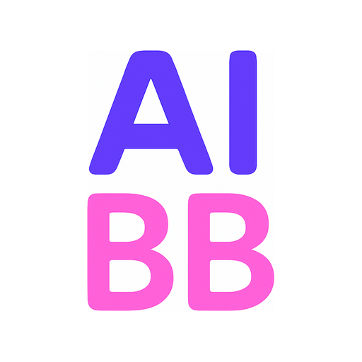

# BeautyOS by AI Beauty Bot



[](https://skills.sh/ai-beauty-bot/beauty-os-skill)

A free salon CRM your AI agent can set up and run: services, staff, clients, online booking and an optional AI receptionist. Available as a Claude Code plugin, Gemini CLI extension, portable [Agent Skill](https://agentskills.io) and remote MCP connection.

Connect an account, create or pick a salon, import services and prices, organize staff and schedules, complete CRM setup, publish online booking, and optionally configure, test and enable the AI receptionist for supported channels. Salon changes are shown as previews and applied after your confirmation. Passwords and channel credentials are entered only on BeautyOS pages, never in chat.

Learn more at [ai-beauty.bot/agents](https://ai-beauty.bot/agents).

## Install

**Using ChatGPT?** You don't need this skill. Open the [BeautyOS app for ChatGPT](https://chatgpt.com/plugins/plugin_asdk_app_6ac8c86fbbc08191b020b493c153ff0b) and start chatting.

Choose one installation method for each agent so it has one BeautyOS connection.

### Claude Code plugin

```sh
claude plugin marketplace add ai-beauty-bot/beauty-os-skill
claude plugin install beautyos@ai-beauty-bot
```

The plugin includes the BeautyOS skill and remote MCP connection. Start a new
session, ask Claude to set up your salon and complete the BeautyOS OAuth sign-in
when prompted. You do not need a client secret or API key.

### Gemini CLI extension

```sh
gemini extensions install https://github.com/ai-beauty-bot/beauty-os-skill
```

Restart Gemini CLI. Authenticate with `/mcp auth beautyos`, then ask it to connect
or set up your salon. The extension includes the same skill and MCP connection.

### Claude web connector

In Claude's custom connector settings, add
`https://agents.ai-beauty.bot/beauty-os/mcp` with OAuth. Choose Claude's published
identity or automatic client registration, then sign in to BeautyOS and approve
the salons to share. The return address is
`https://claude.ai/api/mcp/auth_callback`. This connection does not require
installing the portable skill.

### Portable skill: ask your agent to install it

Paste this into your AI agent (Claude Code, Codex, Hermes Agent, Cursor and others):

> Install the BeautyOS skill for yourself, for all my projects: run `npx skills add ai-beauty-bot/beauty-os-skill --skill beautyos -g -y -a <agent-id>`, replacing `<agent-id>` with your own id from https://github.com/vercel-labs/skills/blob/main/docs/agents.md (for example `claude-code`, `codex` or `hermes-agent`). Then tell me when to start a new conversation so you can use it.

### Portable skill: run the command yourself

Pick the line for your agent and run it in a terminal:

| Agent | Command |
| --- | --- |
| Claude Code | `npx skills add ai-beauty-bot/beauty-os-skill --skill beautyos -g -y -a claude-code` |
| Codex | `npx skills add ai-beauty-bot/beauty-os-skill --skill beautyos -g -y -a codex` |
| Hermes Agent | `npx skills add ai-beauty-bot/beauty-os-skill --skill beautyos -g -y -a hermes-agent` |
| Other agents | See the [supported agent ids](https://github.com/vercel-labs/skills/blob/main/docs/agents.md) |

`-g` installs the skill for your user rather than into the current folder, `-y` skips the questions and `-a` chooses the agent. Keep `-a`: without it the installer may add the skill for every agent it supports.

After installing, start a new conversation or restart the agent so it finds the skill.

## Use

Ask your agent, for example:

> Use the BeautyOS skill to set up my salon. Start by connecting my account.

With the helper, the agent shows a BeautyOS link and a short code; with a native MCP connection, your agent opens its own sign-in. Either way, sign in or register in BeautyOS, choose which salons to share, and approve. Setup then continues in the conversation.

## Requirements

The skill works with any agent that supports [Agent Skills](https://agentskills.io) and has one of these:

- **BeautyOS connected as a native MCP server.** Add `https://agents.ai-beauty.bot/beauty-os/mcp` with OAuth in your agent's MCP settings; the skill then uses those tools directly and needs nothing else. See [native MCP setup](skills/beautyos/references/native-mcp.md) for Claude Code, Codex, Hermes Agent and other clients.
- **Script execution with Node.js 22 or later.** The bundled helper signs in with a short code, needs no MCP configuration and has no npm dependencies. It needs outbound HTTPS and persistent user storage.

You also need a BeautyOS account; registration is available during sign-in. Plan limits and AI allowances apply.

Plain chat apps with neither option cannot use this skill. In ChatGPT, use the [BeautyOS app for ChatGPT](https://chatgpt.com/plugins/plugin_asdk_app_6ac8c86fbbc08191b020b493c153ff0b) instead; the skill points ChatGPT users there too.

## MCP endpoint and sign-in

External agents, the plugins in this repository and the helper use
`https://agents.ai-beauty.bot/beauty-os/mcp`. The published ChatGPT app keeps its
own MCP connection at `https://account.ai-beauty.bot/beauty-os/mcp`. Both connect
to BeautyOS accounts; OAuth connections and tokens are bound to their respective
server address.

Server and tool descriptions are publicly discoverable on the agents endpoint.
Calling tools or reading salon data requires OAuth and the user's current salon
permissions. The [native MCP guide](skills/beautyos/references/native-mcp.md)
describes direct connections for clients that already manage MCP servers.

## Access and privacy

The points about token storage below apply to the helper; with a native MCP connection your agent stores its own tokens.

- One browser approval grants the skill access to what BeautyOS offers agents. What it can do is limited by the salons you shared and your role in each salon, rechecked on every call.
- Access and refresh tokens are stored in `~/.config/beautyos/` (directory `0700`, files `0600`), outside the skill and your projects. `BEAUTYOS_CONFIG_DIR` selects another protected directory.
- The helper serializes calls so rotating tokens are not lost, strips private UI data from results, and never retries writes on its own.
- Ask the agent to log out, or revoke the connection at `https://agents.ai-beauty.bot/beauty-os/connections`.

## Repository layout

```
.claude-plugin/
  plugin.json              Claude Code plugin
  marketplace.json         AI Beauty Bot marketplace
gemini-extension.json      Gemini CLI extension
server.json                MCP Registry descriptor
assets/logo.png            official 512x512 logo
SECURITY.md                vulnerability reporting and access model
skills/beautyos/
  SKILL.md                 instructions the agent loads
  references/onboarding.md setup sequence and source limits
  references/recovery.md   error codes and recovery
  references/native-mcp.md connecting BeautyOS as a native MCP server
  scripts/beautyos.mjs     dependency-free MCP and device-sign-in helper
test/                      helper and distribution-package tests
```

## Development

```sh
npm test
```

Tests use fake network transports, local package files and temporary storage;
they never contact BeautyOS. The repository packages version 1.0.0 under the MIT
license. Its MCP Registry descriptor uses the namespace `bot.ai-beauty/beautyos`;
publication in third-party directories is a separate process.

## Support

Write to support@ai-beauty.bot or [@ai_beauty_support_bot](https://t.me/ai_beauty_support_bot) on Telegram.

Report vulnerabilities using the [security policy](SECURITY.md).

## License

[MIT](LICENSE)
